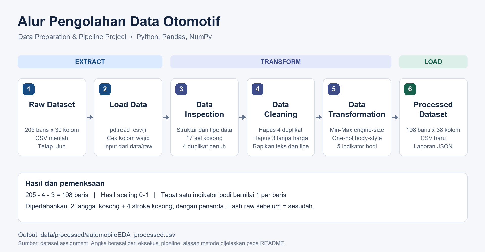

# Data Preparation & Pipeline Project: Dataset Otomotif

**Peserta:** Naufal Ahmad-C24  
**Repository:** `assignment-data-pipeline-naufal-ahmad-c24` (public)

Pipeline ETL sederhana dengan Python, Pandas, dan NumPy untuk mengolah dataset otomotif dari file mentah menjadi dataset hasil yang dapat digunakan untuk analisis lanjutan. Seluruh tahap berjalan melalui satu perintah dan terbagi menjadi function untuk load, inspection, cleaning, transformation, dan save.

## 1. Hasil project

| Indikator | Hasil |
|---|---:|
| Ukuran dataset mentah | 205 baris x 30 kolom |
| Duplikat penuh yang dihapus | 4 baris |
| Baris tanpa harga yang dihapus | 3 baris |
| Ukuran sesudah cleaning | 198 baris x 33 kolom |
| Ukuran dataset hasil transformasi | **198 baris x 38 kolom** |
| Sel kosong sebelum proses | 17 |
| Sel kosong sesudah proses | 6, sengaja dipertahankan dan diberi penanda |
| Duplikat pada dataset hasil | 0 |
| Integritas dataset mentah | SHA-256 sebelum dan sesudah eksekusi sama |

File hasil utama: [`data/processed/automobileEDA_processed.csv`](data/processed/automobileEDA_processed.csv).

## 2. Dataset dan sumber

Dataset disediakan mentor melalui materi **Individual Assignment - Data Engineering: Pipeline & Preparation**, AI Engineering Bootcamp, dalam paket `Dataset_Sesi_3.zip`.

| File dari mentor | Peran |
|---|---|
| `automobileEDA_dirty_training.csv` | Input wajib pipeline, disalin utuh ke `data/raw/` |
| `automobileEDA.csv` | Referensi dataset original; tidak dibaca oleh pipeline |
| `automobile_processed.csv` | Referensi hasil mentor; tidak dibaca atau disalin menjadi hasil |

Satu baris memuat atribut otomotif seperti merek, bodi, jumlah pintu, ukuran mesin, tenaga mesin, konsumsi bahan bakar, harga, dan kolom tanggal pada dataset latihan. Kolom `transaction_date` diperlakukan sebagai tanggal yang disediakan pada file, tanpa mengasumsikan riwayat transaksi dunia nyata. Satuan atau definisi yang tidak dijelaskan pada materi tidak ditambahkan sebagai fakta baru.

Hasil project tidak harus identik dengan referensi mentor: project ini menghapus baris tanpa harga, mempertahankan beberapa nilai kosong yang alasannya terdokumentasi, dan melakukan transformasi pada kolom yang dipilih. Semua hasil dihitung dari input mentah melalui `src/pipeline.py`.

## 3. Struktur folder

```text
data-pipeline-assignment/
|-- data/
|   |-- raw/
|   |   `-- automobileEDA_dirty_training.csv
|   `-- processed/
|       `-- automobileEDA_processed.csv
|-- src/
|   `-- pipeline.py
|-- documentation/
|   |-- data-flow-diagram.png
|   `-- pipeline-report.json
|-- tests/
|   `-- test_pipeline.py
|-- .gitignore
|-- README.md
`-- requirements.txt
```

`pipeline-report.json` adalah laporan tambahan yang dibuat otomatis setiap kali pipeline dijalankan. Laporan memuat kondisi awal, perubahan, contoh transformasi, jumlah data akhir, versi runtime, dan hash dataset mentah. Enam pengujian dalam `tests/` menggunakan `unittest` dari standard library.

## 4. Instalasi dan cara menjalankan

Project diuji pada **Python 3.12.14 dan 3.13.1**, dengan **Pandas 3.0.1 dan NumPy 2.3.5**. Lingkungan `.venv` pada folder lokal tugas disiapkan menggunakan Python 3.13.1. Gunakan Python 3.12 atau 3.13 dengan versi library pada `requirements.txt`; dependensi tidak langsung juga dikunci versinya. Tidak ada API key atau layanan AI yang diperlukan.

### Windows PowerShell

Buka terminal pada folder utama project. Untuk folder lokal tugas ini:

```powershell
Set-Location 'D:\REWORK\Sesi 3\Assignment\data-pipeline-assignment'
python --version
python -m venv .venv
.\.venv\Scripts\python.exe -m pip install -r requirements.txt
.\.venv\Scripts\python.exe src/pipeline.py
```

Pastikan perintah `python` menunjuk ke instalasi Python yang kompatibel. Folder `.venv` hanya dibuat sekali. Pada eksekusi berikutnya cukup jalankan perintah terakhir. Pemanggilan interpreter secara langsung tidak memerlukan aktivasi PowerShell.

Pada folder lokal yang sudah disiapkan, cukup jalankan:

```powershell
Set-Location 'D:\REWORK\Sesi 3\Assignment\data-pipeline-assignment'
.\.venv\Scripts\python.exe src/pipeline.py
```

Lingkungan `.venv` tidak disertakan dalam ZIP/repository. Jika mengunduh atau clone project di lokasi baru, lakukan langkah instalasi lengkap di atas.

### Linux/macOS

Dari folder utama project:

```bash
python3.12 -m venv .venv
.venv/bin/python -m pip install -r requirements.txt
.venv/bin/python src/pipeline.py
```

Lokasi input dan output di kode ditentukan dari lokasi `pipeline.py` menggunakan `pathlib`, sehingga tidak bergantung pada drive D maupun current working directory. Kode dapat dijalankan dari folder lain dengan memberikan lokasi script yang benar.

File yang dibuat/diperbarui secara otomatis:

- `data/processed/automobileEDA_processed.csv`
- `documentation/pipeline-report.json`

## 5. Kondisi awal dan masalah data

Pemeriksaan awal ditampilkan di terminal: lima baris pertama, ukuran, nama dan tipe setiap kolom, missing values setiap kolom, duplikat, serta nilai unik kategori.

### Missing values sebelum deduplikasi

| Kolom | Jumlah kosong |
|---|---:|
| `transaction_date` | 2 |
| `make` | 2 |
| `num-of-doors` | 2 |
| `stroke` | 4 |
| `horsepower` | 3 |
| `price` | 3 |
| `horsepower-binned` | 1 |
| **Total** | **17** |

Masalah lain yang ditemukan:

- Terdapat 4 duplikat penuh, di luar kemunculan pertama. Baris tambahan tersebut berada pada urutan data mentah 202-205, dengan header tidak dihitung sebagai baris data.
- Huruf kategori tidak seragam: `ALFA-ROMERO`, `Audi`, `BMW`, `SEDAN`, `Sedan`, `AWD`, `RWD`, `MPFI`, dan `Mpfi`.
- Terdapat spasi di akhir beberapa nilai `make`, misalnya `dodge  `, `mercury  `, dan `porsche  `.
- `transaction_date` masih berupa teks dengan empat pola tanggal.
- `num-of-doors` dan `num-of-cylinders` berupa kata, padahal dapat direpresentasikan sebagai jumlah numerik.
- `body-style` merupakan kategori nominal yang dipilih untuk encoding.
- `engine-size` memiliki rentang 61-326, sehingga dipilih untuk demonstrasi Min-Max Scaling. `length` dan `width` sudah memiliki nilai berskala kecil dan tidak diproses ulang hanya untuk memenuhi contoh normalisasi.
- Tidak ditemukan nilai nonnumerik pada kolom numerik atau nilai nol/negatif pada atribut yang diperiksa sebagai nilai positif. Tidak ada baris yang dihapus hanya karena harga atau ukuran mesin tergolong tinggi. `symboling` tidak dikenai aturan positif karena nilai negatif memang terdapat pada sumber.

## 6. Data cleaning dan alasan pemilihan metode

Cleaning dilakukan pada salinan DataFrame. File mentah tidak ditulis ulang.

| Urutan | Kolom/proses | Metode dan alasan |
|---:|---|---|
| 1 | Semua kolom kategorikal | Hapus spasi awal/akhir, ubah huruf menjadi kecil, dan seragamkan token kosong. Mencegah kategori yang sama terpecah akibat format penulisan. |
| 2 | Seluruh baris | Hapus duplikat penuh dengan mempertahankan kemunculan pertama. Dilakukan sebelum menghitung median/modus agar duplikat tidak membobotkan nilai pengganti. |
| 3 | `price` | Hapus 3 baris tanpa harga. Project memprioritaskan harga terobservasi untuk analisis harga dan menghindari pembuatan harga pengganti. Ini keputusan metode project, bukan syarat bahwa semua missing harus dihapus. |
| 4 | `transaction_date` | Parse empat pola secara eksplisit. Dua tanggal yang memang kosong tetap `NaT`; tambahkan `transaction_date_missing`. Jangan menebak tanggal dari nomor baris. |
| 5 | `stroke` | Empat nilai kosong semuanya berada pada baris dengan `engine-type=rotor`. Pertahankan kosong dan tambahkan `stroke_missing`, karena belum ada dasar untuk mengganti dengan nilai mesin lain. Keterkaitan ini merupakan temuan data, bukan konfirmasi penyebab missing. |
| 6 | `horsepower` | Isi 3 nilai kosong dengan median **95**, dihitung sesudah deduplikasi dan penghapusan baris tanpa harga. Median sederhana dan lebih tahan terhadap nilai ekstrem daripada mean. Tambahkan `horsepower_imputed` agar nilai pengganti dapat dibedakan. |
| 7 | `num-of-doors` | Isi 2 nilai kosong dengan modus **four**; kemudian petakan `two=2`, `four=4` sebagai integer. Modus mewakili kategori paling sering. |
| 8 | `num-of-cylinders` | Petakan `two=2`, `three=3`, `four=4`, `five=5`, `six=6`, `eight=8`, `twelve=12`. Ini konversi jumlah, bukan pemberian peringkat buatan pada merek/bodi. |
| 9 | `make` | Setelah deduplikasi tersisa 1 nilai kosong, diisi `unknown`. Menghindari tebakan merek berdasarkan merek terbanyak. |
| 10 | `horsepower-binned` | Seragamkan huruf, isi 1 label kosong dengan `unknown`, dan tandai label pada 3 baris hasil imputasi horsepower sebagai `unknown`. Batas bin mentor tidak disediakan, sehingga kategori tidak dihitung ulang dengan batas yang dikarang. |

`AWD` menjadi `awd` dan `RWD` menjadi `rwd`. Kategori `awd` dan `4wd` tetap terpisah; perbedaan istilah tidak otomatis dianggap kesalahan penulisan.

Nilai numerik yang tidak dapat dibaca, nilai tidak finite, kategori jumlah yang tidak dikenal, atau tanggal terisi yang tidak valid akan menghasilkan error yang menjelaskan masalahnya. Dengan demikian, nilai salah tidak diam-diam hilang sebagai missing.

### Aturan tanggal

| Input | Format | Output |
|---|---|---|
| `2025-01-01` | `%Y-%m-%d` | `2025-01-01` |
| `02/01/2025` | `%d/%m/%Y` | `2025-01-02` |
| `01-03-2025` | `%m-%d-%Y` | `2025-01-03` |
| `04-Jan-2025` | `%d-%b-%Y` | `2025-01-04` |

Pola angka `NN-NN-YYYY` diinterpretasikan sebagai bulan-hari-tahun. Asumsi ini didukung nilai tidak ambigu seperti `01-15-2025` dan urutan tanggal pada file. Pola dengan garis miring memakai hari-bulan-tahun, sesuai nilai seperti `26/01/2025`. Seluruh tanggal terisi berhasil diparse dengan aturan tersebut. `dayfirst=True` tidak diterapkan sekaligus pada seluruh kolom campuran.

### Contoh cleaning

Nomor berikut adalah urutan baris data pada CSV mentah, tidak termasuk header.

| Baris data mentah | Kolom | Sebelum | Sesudah |
|---:|---|---|---|
| 3 | `make` | `ALFA-ROMERO` | `alfa-romero` |
| 9 | `body-style` | `SEDAN` | `sedan` sebelum encoding |
| 13 | `drive-wheels` | `AWD` | `awd` |
| 19 | `fuel-system` | `MPFI` | `mpfi` |
| 2 | `transaction_date` | `02/01/2025` | `2025-01-02` |
| 16 | `num-of-doors` | kosong | `4` |
| 21 | `horsepower` | kosong | `95`, dengan `horsepower_imputed=1` |
| 101 | `make` | kosong | `unknown` |

## 7. Data transformation

### A. Min-Max Scaling pada `engine-size`

Kolom dipilih karena numerik, tidak memiliki missing values, dan rentangnya jelas. Kolom asli dipertahankan; hasil ditambahkan sebagai **`engine_size_minmax`** agar perbandingan mudah dilakukan.

```text
x_scaled = (x - minimum) / (maximum - minimum)
minimum = 61
maximum = 326
```

| Baris data mentah | `engine-size` sebelum | `engine_size_minmax` sesudah |
|---:|---:|---:|
| 1 | 130 | 0.2603773585 |
| 18 | 61 | 0.0000000000 |
| 47 | 326 | 1.0000000000 |

Nilai hasil tersimpan sebagai angka, bukan teks berformat. Jika kelak seluruh nilai kolom konstan, kebijakan scaling adalah menghasilkan 0 agar tidak membagi dengan nol.

### B. One-hot encoding pada `body-style`

`body-style` dipilih karena merupakan kategori nominal tanpa urutan tingkat. Memberinya angka berurutan 1-5 dapat menimbulkan kesan peringkat. Digunakan `pd.get_dummies(..., columns=["body-style"], dtype=int)` untuk menghasilkan indikator 0/1.

| Sebelum | convertible | hardtop | hatchback | sedan | wagon |
|---|---:|---:|---:|---:|---:|
| `convertible` | 1 | 0 | 0 | 0 | 0 |
| `hardtop` | 0 | 1 | 0 | 0 | 0 |
| `hatchback` | 0 | 0 | 1 | 0 | 0 |
| `sedan` | 0 | 0 | 0 | 1 | 0 |
| `wagon` | 0 | 0 | 0 | 0 | 1 |

Nama kolom lengkap menggunakan awalan `body-style_`, misalnya `body-style_sedan`. Kolom teks `body-style` diganti oleh lima kolom indikator. Setiap baris harus memiliki tepat satu indikator bernilai 1.

Rekonsiliasi jumlah kolom: **30 kolom awal + 3 penanda + 1 hasil scaling - 1 kolom bodi + 5 indikator bodi = 38 kolom**. Jumlah pintu dan silinder menggantikan isi kolom lama sehingga tidak menambah jumlah kolom.

## 8. Hasil akhir dan nilai kosong yang dipertahankan

```text
205 baris mentah
- 4 duplikat penuh
= 201 baris unik
- 3 baris tanpa price
= 198 baris akhir
```

Enam sel kosong akhir hanya berada pada dua kolom:

| Kolom | Sel kosong | Penanganan |
|---|---:|---|
| `transaction_date` | 2 | Tetap `NaT` di memori, kosong pada CSV; flag `transaction_date_missing=1` |
| `stroke` | 4 | Tetap missing; flag `stroke_missing=1` |

Kolom lain tidak memiliki missing values. Dalam CSV, missing tetap disimpan sebagai field kosong, bukan angka nol. Tanggal ditulis sebagai `YYYY-MM-DD`. CSV tidak menyimpan metadata dtype; jika file dibaca kembali untuk analisis tanggal, gunakan `parse_dates=["transaction_date"]`.

Dataset hasil mendukung analisis dasar dan memenuhi transformasi minimum assignment. Untuk pemodelan tertentu, kolom kategori lain masih perlu encoding dan kebijakan `stroke` perlu disesuaikan dengan kebutuhan model serta pemahaman domain. Bila digunakan untuk evaluasi model, pemisahan train/test dilakukan sebelum mempelajari median, rentang scaling, atau kategori dari data train, agar informasi test tidak masuk ke tahap persiapan. Training model bukan bagian project ini.

## 9. Alur ETL dan function



| ETL | Function utama | Proses |
|---|---|---|
| Extract | `load_data()` | Membaca dataset wajib dari `data/raw/` dan mengecek kolom |
| Transform | `inspect_data()` | Menampilkan pemeriksaan awal di terminal |
| Transform | `clean_data()` | Membersihkan kategori, duplikat, missing, dan tipe data |
| Transform | `transform_data()` | Min-Max Scaling dan one-hot encoding |
| Pemeriksaan hasil | `validate_data()` | Rekonsiliasi baris, rentang scaling, missing, flag, dan indikator encoding |
| Load | `save_data()` | Menyimpan CSV baru ke `data/processed/` dengan `index=False` |

`main()` menghubungkan seluruh tahap dalam satu eksekusi dan menulis laporan JSON. Fungsi save menolak output yang diarahkan ke folder raw. Hash file mentah diperiksa sebelum dan sesudah proses.

## 10. Verifikasi

Jalankan pipeline, kemudian pengujian:

```powershell
.\.venv\Scripts\python.exe src/pipeline.py
.\.venv\Scripts\python.exe -m unittest discover -s tests -v
```

Enam pengujian memeriksa urutan hari/bulan, penolakan tanggal invalid, rekonsiliasi dataset lengkap dan integritas raw, scaling kolom konstan, perlindungan folder raw, serta penolakan kategori jumlah yang tidak dikenal.

Pada verifikasi project, keenam pengujian lulus pada Python 3.12.14 maupun lingkungan lokal Python 3.13.1. Pipeline dijalankan ulang dan juga dijalankan dari current working directory berbeda. Isi CSV dan laporan JSON konsisten pada runtime yang sama; hasil CSV juga identik antara kedua versi Python tersebut. Pemeriksaan dependency (`pip check`) lulus. Dataset mentah sama persis dengan sumber yang disediakan. Bukti ringkasan tiap eksekusi dapat diperiksa pada `documentation/pipeline-report.json`.

SHA-256 dataset mentah:

```text
f5f0791b7f5aee468916819ddcdabb2364cad2ede7e503ac6e76e815b8628113
```

## 11. Pengumpulan ke GitHub

Nama repository mengikuti ketentuan tugas dan identitas peserta: **`assignment-data-pipeline-naufal-ahmad-c24`**. Repository dipilih **public** agar mentor dapat membuka link secara langsung.

1. Buat repository GitHub dengan nama tersebut; pastikan mentor dapat mengaksesnya.
2. Unggah isi project dengan struktur folder tetap utuh. `README.md` harus berada di root repository, bukan tersembunyi dalam satu folder tambahan.
3. Sertakan dataset mentah, dataset hasil, `src`, `documentation`, `requirements.txt`, `.gitignore`, dan pengujian.
4. Jangan unggah `.venv`, cache Python, atau file kredensial. Aturan `.gitignore` berlaku saat menggunakan Git; bila unggah manual, pilih file dengan aturan yang sama.
5. Buka README pada GitHub dan pastikan diagram tampil serta kedua CSV tersedia.
6. Kumpulkan satu link repository. Jika repository private, berikan akses kepada mentor terlebih dahulu.

Semua output wajib sudah berada dalam project yang sama. File referensi mentor tidak diperlukan agar pipeline berjalan.

## 12. Referensi metode

- Materi mentor: *Individual Assignment - Data Engineering: Pipeline & Preparation*; instruksi dataset, struktur project, ETL, dan pengumpulan.
- [Pandas: membaca CSV](https://pandas.pydata.org/docs/reference/api/pandas.read_csv.html)
- [Pandas: menghapus duplikat](https://pandas.pydata.org/docs/reference/api/pandas.DataFrame.drop_duplicates.html)
- [Pandas: membaca tanggal dengan format eksplisit](https://pandas.pydata.org/docs/reference/api/pandas.to_datetime.html)
- [Pandas: one-hot encoding](https://pandas.pydata.org/docs/reference/api/pandas.get_dummies.html)
